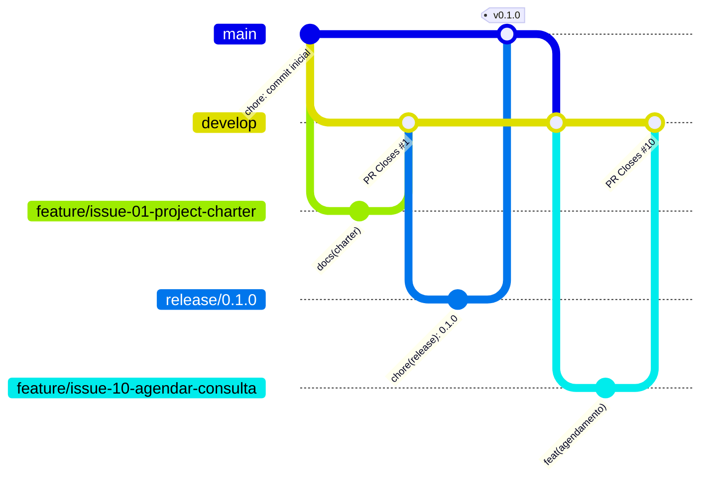

# 🏥 Agenda Saúde UBS

[](https://github.com/Everson9/agenda-saude-ubs/tags)
[](https://github.com/Everson9/agenda-saude-ubs/actions/workflows/ci.yml)
[](LICENSE)
[](https://nodejs.org)
[](https://github.com/Everson9/agenda-saude-ubs/issues)

Sistema web para a **recepção de uma Unidade Básica de Saúde (UBS)** marcar consultas numa agenda
única por especialidade, **sem horário duplicado**, e registrar se o paciente compareceu.

## 🎯 Problema

Em UBS do interior, como as de Tacaratu (PE), a marcação ainda é feita em caderno: o paciente
dorme na fila para marcar, dois pacientes ficam com o mesmo horário e ninguém sabe quantas consultas
foram perdidas. A Agenda Saúde UBS resolve o núcleo desse problema com uma API REST e uma tela
simples, com as regras de funcionamento da UBS validadas pelo sistema.

## ✅ Funcionalidades

| Requisito | Funcionalidade | Status |
|---|---|---|
| RF01 | Cadastrar paciente (cartão SUS único) | ✅ Implementado (v0.2.0) |
| RF02 | Listar e buscar pacientes | ✅ Implementado (v0.2.0) |
| RF03 | Listar especialidades e duração | ✅ Implementado (v0.2.0) |
| RF04 | Agendar com grade, horário, dia útil e conflitos | ✅ Implementado (v0.3.0) |
| RF05 | Agenda por dia, especialidade ou paciente | ✅ Implementado (v0.3.0) |
| RF06 | Cancelar com motivo | ✅ Implementado (v0.3.0) |
| RF07 | Registrar comparecimento ou falta | ✅ Implementado (v0.3.0) |
| RNF04 | Tela web da recepção (responsiva) | ✅ Implementado (v0.3.0) |
| RF08 | Relatório de faltas por especialidade e período | ✅ Implementado (v0.4.0) |
| RNF05 | Login da recepção | 🕒 Planejado (v0.4.0, [#19](https://github.com/Everson9/agenda-saude-ubs/issues/19)) |

## 🧰 Stack

| Camada | Tecnologia | Por quê |
|---|---|---|
| Runtime | Node.js 20+ (ES Modules) | Mesmo JavaScript no back e no front, com `node:test` embutido |
| API | Express 5 | Roteamento simples e erros síncronos tratados nativamente |
| Persistência | Arquivo JSON com escrita atômica | Zero instalação para o MVP. A camada `repositories/` permite trocar por PostgreSQL depois |
| Front-end | HTML, CSS e JavaScript puros | Sem build, servido pelo próprio Express |
| Testes | `node:test` + `fetch` nativo | Unitários (services) e de integração (API) sem dependência extra |
| Qualidade | ESLint 9 + GitHub Actions | Lint e testes em todo PR |

## 🚀 Como rodar localmente

Pré-requisitos: [Node.js 20 ou superior](https://nodejs.org) e Git.

```bash
# 1. clonar
git clone https://github.com/Everson9/agenda-saude-ubs.git
cd agenda-saude-ubs

# 2. instalar as dependências
npm install

# 3. subir o servidor (http://localhost:3000)
npm start

# modo desenvolvimento (reinicia ao salvar)
npm run dev
```

Abra **http://localhost:3000** para usar a tela da recepção. Os dados ficam em `data/db.json`,
criado na primeira gravação.

| Variável | Padrão | Uso |
|---|---|---|
| `PORT` | `3000` | Porta HTTP |
| `DB_ARQUIVO` | `data/db.json` | Arquivo onde os dados são salvos |

### Testes e lint

```bash
npm test                # testes unitários (tests/unit) e de integração (tests/integration)
npm run test:coverage   # mesmos testes + gate de cobertura (Node 22 ou superior)
npm run lint            # ESLint
```

### Quality gates

Um PR só entra na `develop` com todos os portões verdes no GitHub Actions:

| Portão | Ferramenta | Critério |
|---|---|---|
| Padrão de código | ESLint | zero erros |
| Testes | `node:test` em Node 20 e 22 | todos passando |
| Cobertura | `node --test --experimental-test-coverage` | linhas ≥ 80%, funções ≥ 80%, ramos ≥ 70% |
| Segredos vazados | [Gitleaks](https://github.com/gitleaks/gitleaks) | nenhum segredo no histórico inteiro |
| Dependências | `npm audit` | nenhuma vulnerabilidade alta ou crítica |

### Exemplo de uso da API

```bash
curl -X POST localhost:3000/api/pacientes -H "content-type: application/json" \
  -d '{"nome":"Maria da Silva","cartao_sus":"898001234567890","telefone":"87999990000","data_nascimento":"1980-05-12"}'

curl -X POST localhost:3000/api/agendamentos -H "content-type: application/json" \
  -d '{"paciente_id":1,"especialidade_id":1,"data_hora":"2026-11-16T09:00"}'

curl "localhost:3000/api/agendamentos?data=2026-11-16"
```

A lista completa de rotas está em [docs/arquitetura.md](docs/arquitetura.md#api).

## 📚 Documentação

| Documento | Conteúdo |
|---|---|
| [Termo de Abertura](docs/project-charter.md) | Justificativa, objetivos SMART, escopo, stakeholders e riscos |
| [Requisitos](docs/requisitos.md) | RF01 a RF08, regras de negócio, RNF01 a RNF07 e matriz de rastreabilidade |
| [Casos de Uso](docs/casos-de-uso.md) | Atores, diagrama e fluxos principal, alternativo e de exceção |
| [Histórias de Usuário](docs/user-stories.md) | US01 a US07 com critérios de aceite em Gherkin |
| [Arquitetura](docs/arquitetura.md) | C4, camadas, diagrama de classes, DER, estados e rotas da API |
| [Contribuindo](CONTRIBUTING.md) | Git Flow, padrão de commit e checklist de PR |
| [Changelog](CHANGELOG.md) | O que entrou em cada versão |

## 🗂️ Estrutura do projeto

```text
agenda-saude-ubs/
├── .github/
│   ├── ISSUE_TEMPLATE/          # modelos de issue (feature, bug, documentação)
│   ├── pull_request_template.md
│   └── workflows/ci.yml         # lint + testes em todo PR
├── docs/                        # especificação do projeto
├── src/
│   ├── config/                  # porta, arquivo do banco, horário da UBS
│   ├── database/                # jsonStore (escrita atômica) e seed
│   ├── repositories/            # acesso aos dados por entidade
│   ├── services/                # regras de negócio
│   ├── routes/                  # rotas HTTP (Express)
│   ├── middlewares/             # tratamento de erros
│   ├── utils/                   # datas e erros da aplicação
│   ├── public/                  # tela da recepção (HTML, CSS, JS)
│   ├── app.js                   # monta as camadas
│   └── server.js                # sobe o servidor
├── tests/
│   ├── unit/                    # services e utils
│   └── integration/             # API ponta a ponta
├── CHANGELOG.md
├── CONTRIBUTING.md
├── LICENSE
└── README.md
```

## 🌿 Fluxo de branches (Git Flow)



| Branch | Origem | Destino | Uso |
|---|---|---|---|
| `main` | — | — | Produção. Só recebe `release/*` e `hotfix/*`, sempre com tag SemVer |
| `develop` | `main` | `release/*` | Integração das features |
| `feature/issue-NN-descricao` | `develop` | `develop` (PR) | Uma issue por branch |
| `fix/issue-NN-descricao` | `develop` | `develop` (PR) | Correção de bug encontrado no desenvolvimento |
| `release/X.Y.Z` | `develop` | `main` e `develop` | Fechar a versão: changelog, versão no `package.json` e tag |
| `hotfix/X.Y.Z` | `main` | `main` e `develop` | Correção urgente em produção |

**Commits:** [Conventional Commits](https://www.conventionalcommits.org/pt-br/), sempre com a issue:
`feat(agendamento): validar grade da especialidade (#10)`.
**Versões:** [SemVer](https://semver.org/lang/pt-BR/), com tags anotadas `v0.1.0`, `v0.2.0` e `v0.3.0`
e as notas em [Releases](https://github.com/Everson9/agenda-saude-ubs/releases).

## 🗺️ Roadmap

- [x] **v0.1.0**: especificação (charter, requisitos, casos de uso, user stories) e estrutura do projeto
- [x] **v0.2.0**: persistência, pacientes e especialidades
- [x] **v0.3.0**: agendamento completo, tela da recepção, testes e CI
- [ ] **v0.4.0**: relatório de faltas (#18) e login da recepção (#19)

## 📄 Licença

[MIT](LICENSE) © 2026 Everson José
