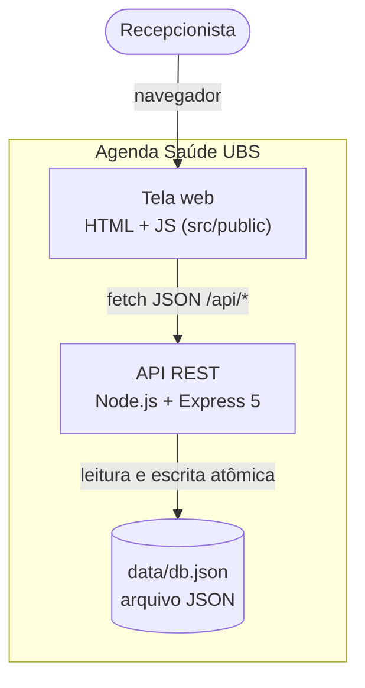
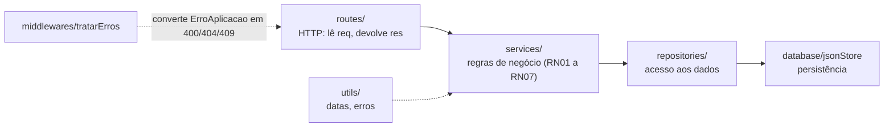
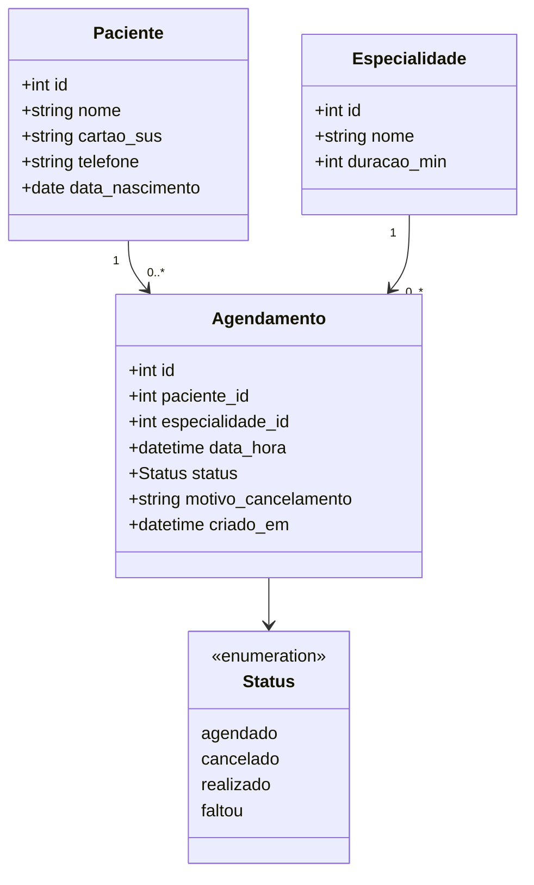
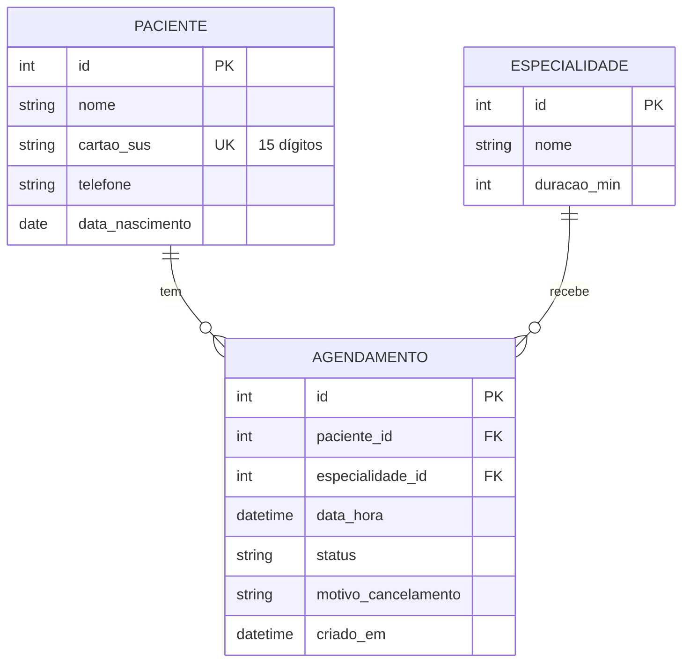
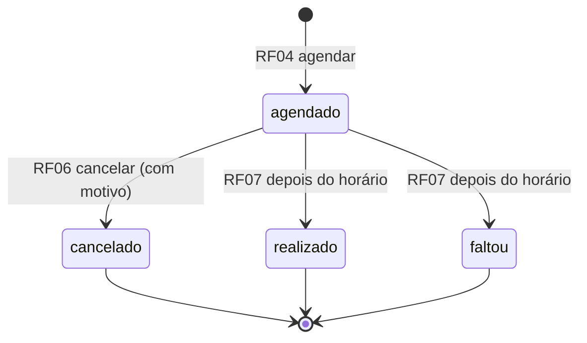

# Arquitetura

## Visão geral (C4 — nível 1 e 2)

## Camadas (C4 — nível 3)

A requisição desce pelas camadas, e cada uma só conhece a de baixo:

| Pasta | Responsabilidade | Não pode |
|---|---|---|
| `src/routes` | Traduzir HTTP para chamada de service | Ter regra de negócio |
| `src/services` | Validar e aplicar as regras (RN01 a RN07) | Conhecer `req`/`res` |
| `src/repositories` | Ler e gravar entidades | Validar regra |
| `src/database` | Guardar em arquivo de forma atômica | Conhecer as entidades |
| `src/middlewares` | Tratar erros e rota inexistente | — |
| `src/utils` | Funções puras (datas, erros) | Ter estado |
| `src/config` | Porta, arquivo do banco e horário da UBS | — |
| `src/public` | Tela da recepção | Acessar o banco direto |

**Por que assim:** as regras ficam nos services, que recebem as dependências por parâmetro (injeção
de dependência). Isso deixa os testes unitários rodarem sem HTTP e com o relógio controlado
(`agora`). Trocar o JSON por PostgreSQL depois só muda `database/` e `repositories/`.

## Diagrama de classes (domínio)

## Modelo de dados (DER)

## Ciclo de vida do agendamento

## API

| Método | Rota | Requisito | Respostas |
|---|---|---|---|
| GET | `/api/saude` | — | 200 |
| POST | `/api/pacientes` | RF01 | 201, 400, 409 |
| GET | `/api/pacientes?busca=` | RF02 | 200 |
| GET | `/api/pacientes/:id` | RF02 | 200, 404 |
| GET | `/api/especialidades` | RF03 | 200 |
| POST | `/api/agendamentos` | RF04 | 201, 400, 404, 409 |
| GET | `/api/agendamentos?data=&especialidade_id=&paciente_id=` | RF05 | 200, 400 |
| PATCH | `/api/agendamentos/:id/cancelar` | RF06 | 200, 400, 404, 409 |
| PATCH | `/api/agendamentos/:id/comparecimento` | RF07 | 200, 400, 404, 409 |

Erros sempre no formato `{ "erro": "mensagem em português" }`.
