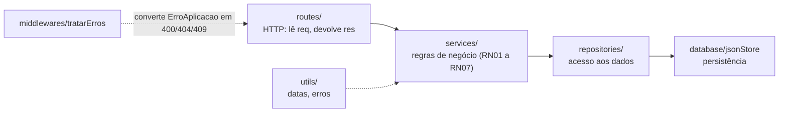
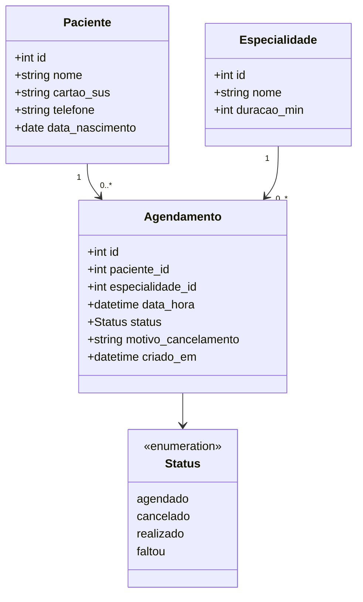
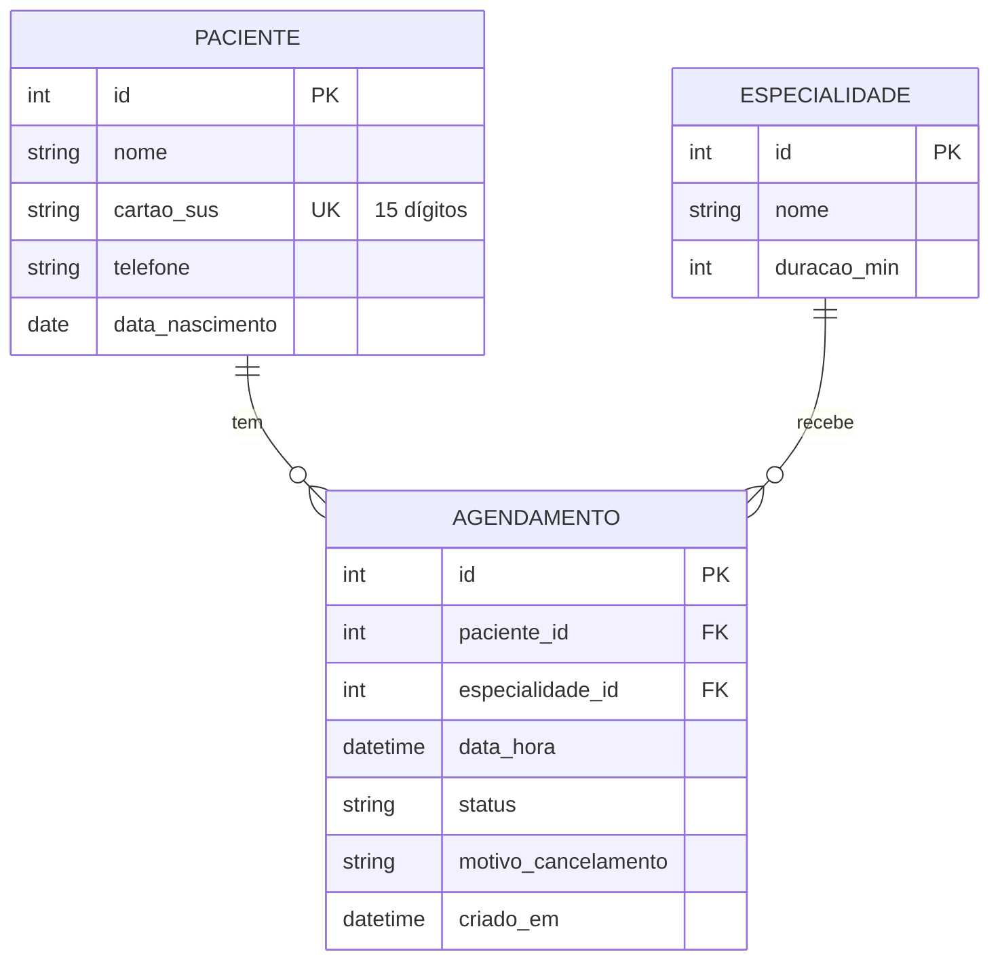
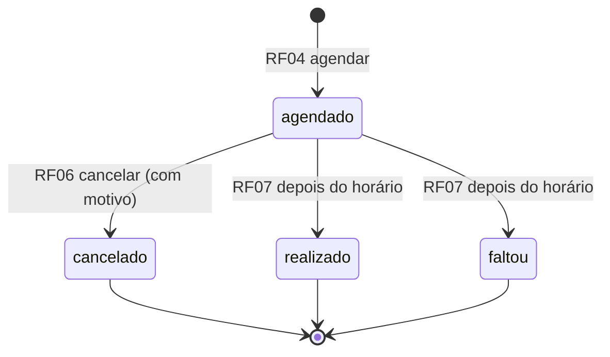

# Arquitetura

## Visão geral (C4 — nível 1 e 2)


## Camadas (C4 — nível 3)

A requisição desce pelas camadas, e cada uma só conhece a de baixo:



| Pasta | Responsabilidade | Não pode |
|---|---|---|
| `src/routes` | Traduzir HTTP para chamada de service | Ter regra de negócio |
| `src/services` | Validar e aplicar as regras (RN01 a RN07) | Conhecer `req`/`res` |
| `src/repositories` | Ler e gravar entidades | Validar regra |
| `src/database` | Guardar em arquivo de forma atômica | Conhecer as entidades |
| `src/middlewares` | Tratar erros e rota inexistente | — |
| `src/utils` | Funções puras (datas, erros) | Ter estado |
| `src/config` | Porta, arquivo do banco e horário da UBS | — |
| `src/public` | Tela da recepção | Acessar o banco direto |

**Por que assim:** as regras ficam nos services, que recebem as dependências por parâmetro (injeção
de dependência). Isso deixa os testes unitários rodarem sem HTTP e com o relógio controlado
(`agora`). Trocar o JSON por PostgreSQL depois só muda `database/` e `repositories/`.

## Diagrama de classes (domínio)



## Modelo de dados (DER)



## Ciclo de vida do agendamento



## Concorrência no agendamento (DATA-ATOMIC)

Duas recepcionistas podem tentar marcar o mesmo horário ao mesmo tempo. A API garante que só uma
consegue, e a outra recebe **409**:

1. O Node.js executa JavaScript numa única thread. Uma requisição só cede a vez para outra num `await`
   ou num callback.
2. Em `agendamentoService.agendar`, a busca por conflito (`agendamentos.ativos()`) e a gravação
   (`agendamentos.criar`) são **síncronas** e ficam no mesmo bloco, sem nenhum `await` entre elas.
   O `jsonStore` também grava de forma síncrona (`writeFileSync` + `renameSync`).
3. Por isso a segunda requisição só começa a verificar depois que a primeira já gravou, e encontra o
   horário ocupado.

**Prova:** `tests/integration/concorrencia.api.test.js` dispara 20 requisições em paralelo para o mesmo
horário e confere que sai exatamente um 201 e dezenove 409.

**Limite conhecido:** a garantia vale para **um processo**. Com mais de uma instância da API sobre o
mesmo arquivo, seria preciso trocar o JSON por um banco com restrição única
(`UNIQUE (especialidade_id, data_hora)` para agendamentos ativos) ou trava de arquivo.

## API

| Método | Rota | Requisito | Respostas |
|---|---|---|---|
| GET | `/api/saude` | — (pública) | 200 |
| POST | `/api/auth/login` | RNF05 (pública) | 200, 401 |
| POST | `/api/pacientes` | RF01 | 201, 400, 409 |
| GET | `/api/pacientes?busca=` | RF02 | 200 |
| GET | `/api/pacientes/:id` | RF02 | 200, 404 |
| GET | `/api/especialidades` | RF03 | 200 |
| POST | `/api/agendamentos` | RF04 | 201, 400, 404, 409 |
| GET | `/api/agendamentos?data=&especialidade_id=&paciente_id=` | RF05 | 200, 400 |
| PATCH | `/api/agendamentos/:id/cancelar` | RF06 | 200, 400, 404, 409 |
| PATCH | `/api/agendamentos/:id/comparecimento` | RF07 | 200, 400, 404, 409 |
| GET | `/api/relatorios/faltas?inicio=&fim=` | RF08 | 200, 400 |

Todas as outras rotas exigem `Authorization: Bearer <token>` e devolvem **401** sem ele, com token adulterado
ou vencido (8 horas).

### Formato de erro (API-ERR)

Todo erro sai no mesmo esquema. `erro` é para a pessoa ler; `codigo` é estável e serve para o cliente decidir
o que fazer sem depender do texto:

```json
{ "erro": "horário já ocupado para esta especialidade", "codigo": "HORARIO_OCUPADO", "status": 409 }
```

| Código | Status | Quando |
|---|---|---|
| `REQUISICAO_INVALIDA` | 400 | Campo faltando ou fora do formato |
| `JSON_INVALIDO` | 400 | Corpo da requisição não é JSON válido |
| `HORARIO_NO_PASSADO` | 400 | RN05 |
| `FORA_DO_FUNCIONAMENTO` | 400 | RN01: fim de semana ou fora das 07:00 às 17:00 |
| `FORA_DA_GRADE` | 400 | RN02 |
| `NAO_AUTORIZADO` | 401 | Sem token, token adulterado |
| `CREDENCIAIS_INVALIDAS` | 401 | Login com usuário ou senha errados |
| `SESSAO_EXPIRADA` | 401 | Token com mais de 8 horas |
| `NAO_ENCONTRADO` | 404 | Paciente, especialidade ou agendamento inexistente |
| `ROTA_NAO_ENCONTRADA` | 404 | Rota da API que não existe |
| `CONFLITO` | 409 | Conflito genérico |
| `CARTAO_SUS_DUPLICADO` | 409 | RF01: cartão SUS já cadastrado |
| `HORARIO_OCUPADO` | 409 | RN03 |
| `PACIENTE_JA_AGENDADO_NO_DIA` | 409 | RN04 |
| `AGENDAMENTO_FINALIZADO` | 409 | RN06: agendamento já cancelado, realizado ou com falta |
| `ERRO_INTERNO` | 500 | Falha inesperada (detalhe só no log) |

Código novo entra nesta tabela no mesmo PR. Código existente não muda de nome (quebraria o cliente).
