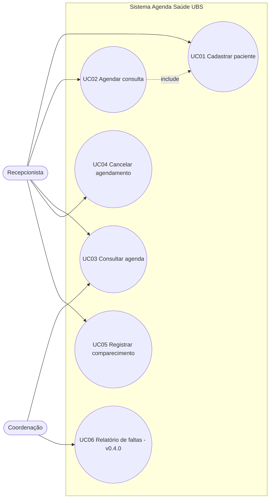

# Casos de Uso

## Atores

| Ator | Tipo | Descrição |
|---|---|---|
| **Recepcionista** | Primário | Funcionário da recepção da UBS. Cadastra pacientes, agenda, cancela e registra o comparecimento. |
| **Paciente** | Secundário | Pede a consulta presencialmente ou por telefone. Não usa o sistema nesta versão. |
| **Coordenação** | Secundário | Consulta a agenda e, na v0.4.0, o relatório de faltas. |

## Diagrama

---

## UC01 — Cadastrar paciente ([RF01], [RF02])

- **Ator:** Recepcionista
- **Pré-condição:** nenhuma.
- **Pós-condição:** paciente salvo e disponível para agendamento.

**Fluxo principal**
1. A recepcionista informa nome, cartão SUS, telefone e data de nascimento.
2. O sistema remove pontos e espaços do cartão SUS.
3. O sistema valida os campos.
4. O sistema confere se o cartão SUS ainda não existe.
5. O sistema salva o paciente e devolve o cadastro com o `id`.

**Fluxo alternativo**
- **A1 — Paciente já cadastrado:** antes do passo 1, a recepcionista busca pelo nome ou cartão (RF02). Encontrando o paciente, segue direto para o UC02.

**Fluxos de exceção**
- **E1 — Dado inválido (passo 3):** nome com menos de 3 letras, cartão sem 15 dígitos ou data de nascimento inválida ou futura. O sistema responde **400** com a mensagem do erro.
- **E2 — Cartão duplicado (passo 4):** o sistema responde **409** "já existe paciente com este cartão SUS".

---

## UC02 — Agendar consulta ([RF03], [RF04])

- **Ator:** Recepcionista
- **Pré-condição:** paciente cadastrado (UC01).
- **Pós-condição:** agendamento criado com status `agendado`, ocupando o horário.

**Fluxo principal**
1. A recepcionista escolhe o paciente, a especialidade e a data e hora.
2. O sistema confere se o paciente e a especialidade existem.
3. O sistema valida a data e hora: formato, data real, não está no passado, dia útil, dentro do funcionamento e na grade da especialidade ([RN01], [RN02], [RN05]).
4. O sistema confere se o horário está livre na especialidade ([RN03]).
5. O sistema confere se o paciente não tem outro agendamento na mesma especialidade no dia ([RN04]).
6. O sistema cria o agendamento e responde **201**.

**Fluxo alternativo**
- **A1 — Horário ocupado:** a recepcionista consulta a agenda do dia (UC03), escolhe outro horário livre e volta ao passo 1.

**Fluxos de exceção**
- **E1 — Paciente ou especialidade inexistente (passo 2):** **404**.
- **E2 — Horário inválido (passo 3):** **400**, com o motivo (ex.: "a UBS só atende de segunda a sexta").
- **E3 — Conflito (passos 4 e 5):** **409**.

---

## UC03 — Consultar agenda ([RF05])

- **Atores:** Recepcionista e Coordenação
- **Fluxo principal:**
  1. O ator escolhe o dia (e, se quiser, a especialidade ou o paciente).
  2. O sistema lista os agendamentos em ordem de horário, com o nome do paciente, a especialidade e o status.
- **Exceção E1:** data num formato diferente de AAAA-MM-DD gera **400**.

---

## UC04 — Cancelar agendamento ([RF06])

- **Ator:** Recepcionista
- **Pré-condição:** agendamento com status `agendado`.
- **Pós-condição:** status `cancelado`, motivo salvo e horário liberado.

**Fluxo principal**
1. A recepcionista escolhe o agendamento e informa o motivo.
2. O sistema confere se o agendamento existe e ainda está `agendado` ([RN06]).
3. O sistema grava o status `cancelado` e o motivo.

**Fluxos de exceção**
- **E1 — Motivo vazio:** **400**.
- **E2 — Agendamento inexistente:** **404**.
- **E3 — Já cancelado ou finalizado:** **409**.

---

## UC05 — Registrar comparecimento ([RF07])

- **Ator:** Recepcionista
- **Pré-condição:** agendamento `agendado` cujo horário já passou ([RN07]).
- **Pós-condição:** status `realizado` ou `faltou`.

**Fluxo principal**
1. Depois do horário, a recepcionista marca "Compareceu" ou "Faltou".
2. O sistema valida o status e o horário.
3. O sistema grava o status final.

**Fluxos de exceção**
- **E1 — Status diferente de `realizado` ou `faltou`:** **400**.
- **E2 — Horário ainda não chegou:** **400**.
- **E3 — Já registrado ou cancelado:** **409**.
